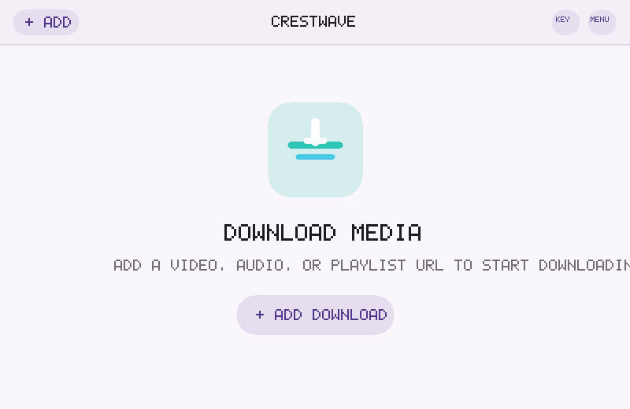
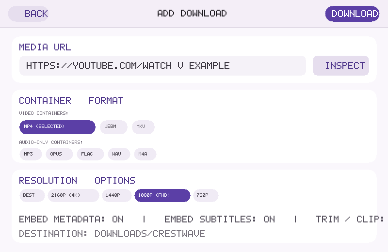
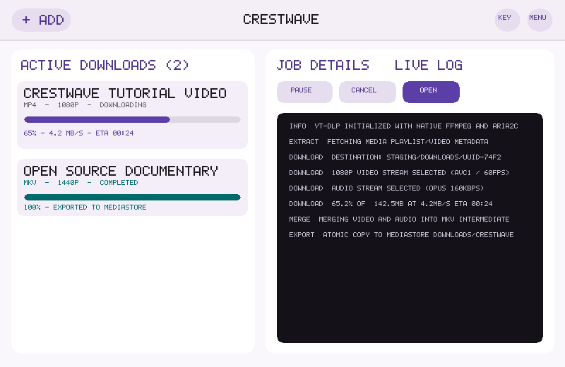
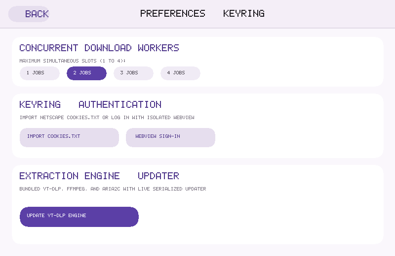

# CrestWave for Android

An open-source media downloader for Android combining the `yt-dlp` + `FFmpeg` + `aria2c` native backend with an Expressive Material 3 adaptive Jetpack Compose user interface designed for phones, foldables, tablets, and desktop/laptop window environments.

## Screenshots

| 1. Homepage & Empty State | 2. Add Download Sheet |
|:---:|:---:|
|  |  |
| *Clean Material 3 Expressive start screen with CrestWave emblem and tonal quick actions.* | *Format selector (MP4/WebM/MKV, MP3/Opus/FLAC/WAV), resolution, clipping, and subtitles.* |

| 3. Active Queue & Live Process Log | 4. Keyring & Preferences |
|:---:|:---:|
|  |  |
| *Split list-detail pane on wide screens with real-time transfer progress and live sanitized logs.* | *Concurrency slider (1–4), cookies.txt import, isolated HTTPS WebView sign-in, and engine updater.* |

---

## Key Features

- **Adaptive Expressive Material 3 Shell**: Fluid layouts that scale from handheld phones to wide multi-window laptops and desktop monitors. Includes a top header bar with `+ Add`, centered title, Keyring (`🔑`) shortcut, and overflow menu.
- **URL Inspection & Stream Selection**: Inspect single items or playlists with `--dump-single-json --flat-playlist` and full cancellation support. Choose resolution ceilings or exact stream IDs, audio languages, and multi-entry playlist downloads.
- **Post-Processing & Custom Containers**:
  - Video: `MP4`, `WEBM`, `MKV` (merged through MKV and recoded).
  - Audio-only: `MP3`, `OPUS`, `FLAC`, `WAV`, `M4A`.
  - Precision time-range clipping (`--download-sections` with `--force-keyframes-at-cuts`) with one-tap chapter bounds.
  - Subtitles: extraction, language filtering, conversion (SRT, VTT, ASS), and embedding.
  - Metadata & chapters embedding, cover art embedding, and SponsorBlock category removal.
- **Isolated Credentials & Keyring**:
  - Cookies are stored strictly in private app storage (`noBackupFilesDir`) and isolated from backups.
  - Import standard Netscape `cookies.txt` files or sign in via an isolated HTTPS WebView session with automatic Netscape cookie extraction.
  - Each concurrent job runs with an independent, temporary cookie snapshot to prevent concurrency corruption.
- **Scoped Storage & Atomicity**:
  - Downloads are staged privately in internal storage during transfer and post-processing.
  - Completed files are atomically published to `Downloads/CrestWave` via MediaStore (Android 10+) or user-selected Storage Access Framework (SAF) trees.
- **Background Persistence & Gating**:
  - Managed by WorkManager foreground workers (`FOREGROUND_SERVICE_DATA_SYNC`).
  - Strict concurrency control (`DownloadGate`) supporting 1–4 simultaneous transfers with graceful pause, resume (`--continue`), and cancellation.

---

## Build & Development

The project is built targeting Android 16 (API 36) with Android 8 (API 26) as the minimum supported SDK baseline.

Dependencies are pinned in `gradle/libs.versions.toml`:
- Kotlin 2.2.21, AGP 8.13.2
- Jetpack Compose Material 3 1.4.0 & Adaptive 1.2.0 (`NavigableListDetailPaneScaffold`)
- Dagger Hilt & Hilt WorkManager injection
- Room 2.8.3 (`DownloadDatabase`) & Preferences DataStore 1.1.7
- `youtubedl-android` 0.18.1 with FFmpeg and aria2c native libraries (ABIs: `arm64-v8a`, `armeabi-v7a`, `x86_64`, `x86`)

### Compiling from CLI

```sh
# Run JVM unit tests across core domain and UI logic
./gradlew :core:test :app:testDebugUnitTest

# Assemble debug APK
./gradlew :app:assembleDebug

# Assemble signed release bundle
./gradlew :app:bundleRelease
```
